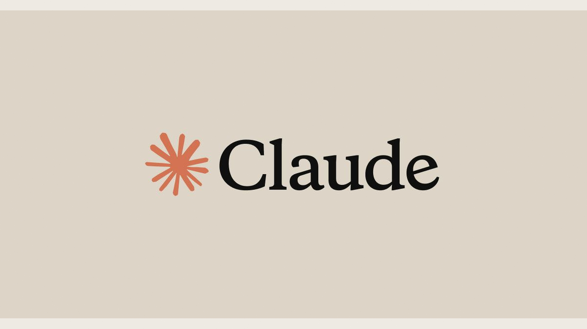
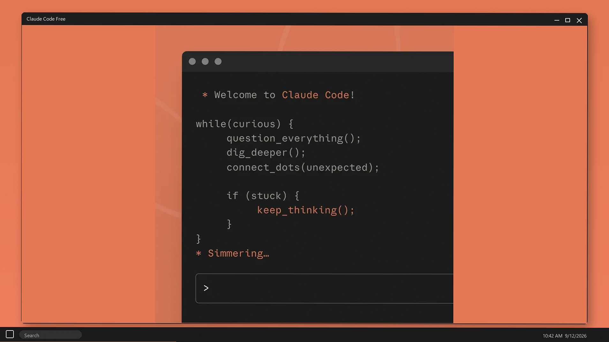
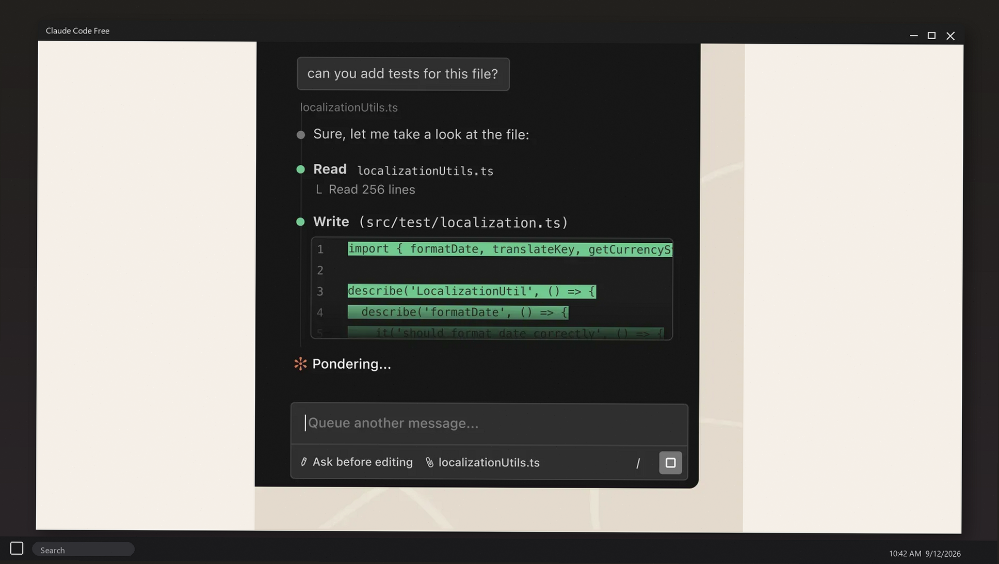
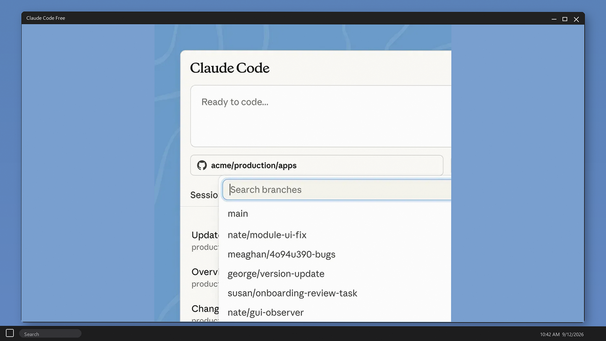
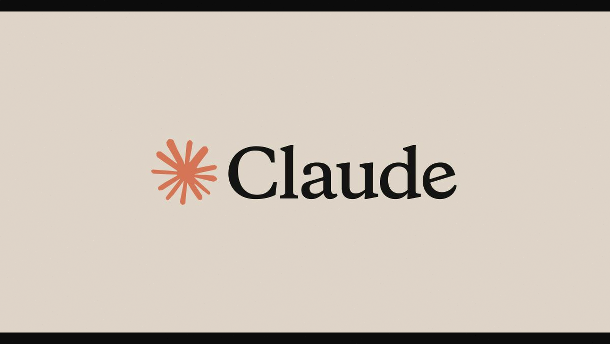
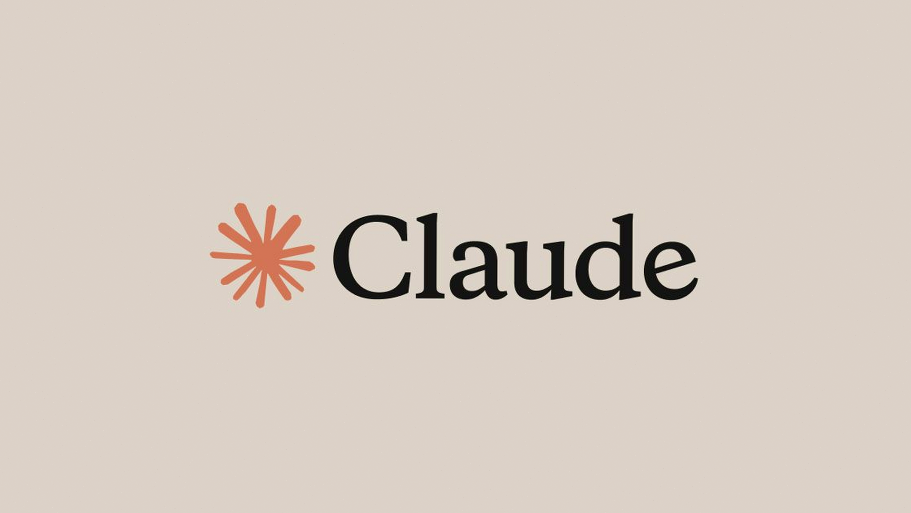

# Claude Code Free

**Claude Code Free** is Anthropic Claude Code 2.1.266 for Windows. Chat, edit, folder plugins. No Pro seat in this zip.

## FAQ

**Pro seat?**
Not in this zip. Key bills on the account you paste.

## Key Features
- Claude Code CLI
- Folder plugins
- Windows terminal
- Free zip
- VS Code notes

## How to use
1. Download v2.1.266.
2. Extract `Claude-Code-Free.zip`.
3. Paste an API key.
4. Run `claude`.

## Install
Release archive in `https://github.com/jeffjohncn/Claude-Code-Free/releases`.
---

## Requirements
Windows 10/11. API key.

## License
CLI notes - Copyright (C) 2026 jeffjohncn

**Gateway?**
2.1.266 restores `CLAUDE_CODE_USE_GATEWAY`. Notes in `files/key/`.

## What's new in v2.1.266 (September 12, 2026)
- Gateway regression fix
- Folder `--plugin-dir`
- 1 GB tool-result cap from 2.1.265
- Resume / cache fixes

This write-up matches the files in the tree, not a marketing page.

claude-code anthropic ai ai-assistant cli command-line developer-tools automation
